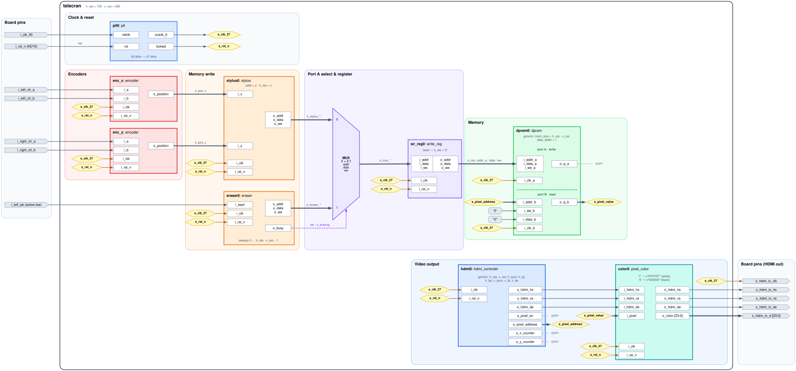
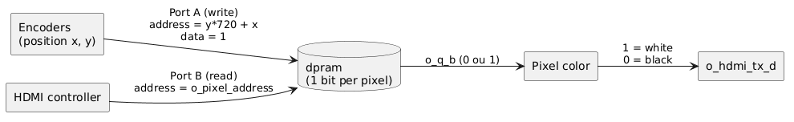

# Magic Screen / Telecran — FPGA Lab (DE10-Nano)

A digital Etch-A-Sketch ("magic screen") built on a Terasic DE10-Nano board (Cyclone V, `5CSEBA6U23I7`), driven by two rotary encoders and displayed over HDMI. Turning the encoders moves a drawing cursor across a 720x480 frame; the trail it leaves is kept in a dual-port RAM framebuffer and streamed out to the screen in real time. Pressing both encoder buttons together erases the drawing.

FPGA Digital Design Laboratory, ENSEA (Cergy, France), semester 7 — by [Ana Carolina Kinoshita Uehara](https://github.com/anauehara) and [Arthur Pinheiro Marinho](https://github.com/Arthurpmarinho). The full lab report is in [`TP_1/report.pdf`](TP_1/report.pdf).

## Repository layout

| Path | Contents |
| --- | --- |
| [`TP_1/`](TP_1) | The Magic Screen project (this README) |
| [`Class_1/`](Class_1) | Earlier, standalone tutorials (LED blink, Quartus/ModelSim tutorial) done before the main project |

## How it works



- **Encoders** — each rotary encoder outputs two quadrature signals (A/B) plus a push button. A debounce circuit (a counter that only lets the output follow the input once it has been stable for 27 000 cycles, 1 ms at 27 MHz) removes the bounce of the mechanical contacts. An edge detector then turns A/B transitions into increment/decrement pulses on a signed position register (16 bits, to avoid the register wrapping at a value that is not a multiple of the screen resolution).
- **Pixel position** — each encoder's position is added to the centre of the screen (360, 240) and reduced modulo the resolution (720x480), so the cursor wraps around at the edges instead of disappearing.
- **Memory write path** — the (x, y) position is turned into a linear RAM address (`y * 720 + x`) and a "pixel on" bit is written whenever the cursor moves. An erase state machine shares the same write port: when both encoder buttons are pressed, it takes priority over drawing and sweeps the whole memory writing zeros (~12.8 ms for the 345 600 addresses, faster than one video frame).
- **Memory** — a dual-port RAM (`dpram`), 345 600 x 1 bit (one bit per pixel of the 720x480 frame). Port A writes new pixels from the encoders/erase logic; Port B is read continuously by the HDMI controller, so the display never has to pause for a write.
- **HDMI controller** — generates the 720x480/59.94 Hz video timing (HSYNC, VSYNC, data-enable, pixel address) from a 27 MHz pixel clock produced by a PLL from the board's 50 MHz clock. A 4x4-pixel cursor is drawn by comparing the controller's counters with the encoder position; the output pixel is white when the cursor is on it or the memory bit read for that address is 1, and black otherwise.

### Framebuffer read/write



## Modules

| Module | What it does | Folder |
| --- | --- | --- |
| `encoder` | Quadrature decoder with debounce and edge detection; increments/decrements a signed position register | [`TP_1/encoder.vhdl`](TP_1/encoder.vhdl) |
| `debounce` | Synchronizes and debounces an input signal (used on A, B and the push button) | [`TP_1/debounce.vhdl`](TP_1/debounce.vhdl) |
| `hdmi_controler` | 720x480 HDMI timing generator (HSYNC/VSYNC/DE, pixel address) | [`TP_1/HDMI`](TP_1/HDMI) |
| `telecran` | Top-level design: wires the encoders, framebuffer and HDMI controller together, plus the HDMI I2C configuration and PLL | [`TP_1/telecran`](TP_1/telecran) |
| `dpram` | Dual-port RAM framebuffer (345 600 x 1 bit) | [`TP_1/telecran/dpram.vhd`](TP_1/telecran/dpram.vhd) |

## Resource utilisation

Target device: Cyclone V `5CSEBA6U23I7` (DE10-Nano), Quartus Prime Lite 24.1.

| Resource | Used / available | Utilisation |
| --- | --- | --- |
| Logic (ALMs) | 742 / 41,910 | 2% |
| Registers | 331 | — |
| Pins | 57 / 314 | 18% |
| Block memory bits | 345,600 / 5,662,720 | 6% |
| DSP blocks | 2 / 112 | 2% |
| PLLs | 1 / 6 | 17% |

The framebuffer accounts for essentially all of the block memory used (720x480 one-bit pixels); storing the same image at 24 bits per pixel would not fit in the device's 5.66 Mbit of block RAM, which is why the design uses one bit per pixel. The two DSP blocks implement the `× 720` multiplications used to turn (x, y) into a linear address. See [`TP_1/quartus_flow_summary.txt`](TP_1/quartus_flow_summary.txt) for the full Quartus report and [`TP_1/rtl.pdf`](TP_1/rtl.pdf) for the synthesized RTL schematic.

## Hardware test results

| Feature | Status |
| --- | --- |
| Encoder, both directions, LEDs | OK |
| HDMI output visible in VLC | OK |
| Moving white pixel | OK |
| Drawing persists (dpram) | OK |
| Erase | OK |

Two issues came up during board bring-up (full write-up in the report):
1. **Pixel jump mid-screen** — the position register was 10 bits (range −512..511), which is not a multiple of the 720-pixel screen width, so the wrap-around landed the cursor on the wrong side of the screen. Fixed by widening the register to 16 bits.
2. **Encoder bounce** — mechanical contact bounce on the encoder was counted as real rotation, moving the cursor far faster than the knob was turned. Fixed with the debounce circuit described above.

## Simulation

Each timing-sensitive module (`encoder`, `hdmi_controler`, `debounce`, `frequency_divider`) has a ModelSim `.do` script next to it. Open ModelSim in the module's folder and run:

```tcl
do <module>.do
```

## Building for the board

1. Open `TP_1/telecran/telecran.qpf` in Quartus Prime (Lite Edition, tested with 24.1).
2. Compile the design (`Compile Design`).
3. Program the DE10-Nano via the `USB BLASTER II` port with the generated `.sof` file.

Full board wiring (LEDs, encoders, HDMI pins) is listed in [`TP_1/fpga_tp_english.md`](TP_1/fpga_tp_english.md) and in the report's pin assignment table.
