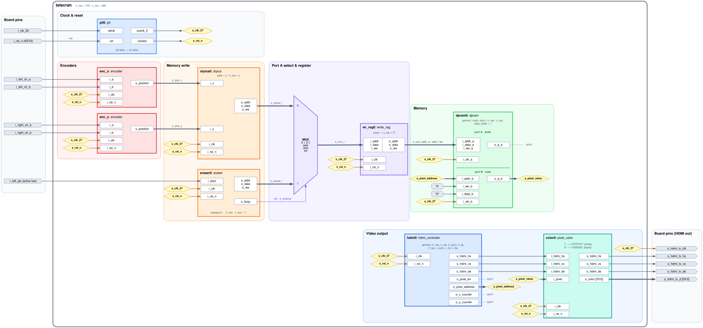
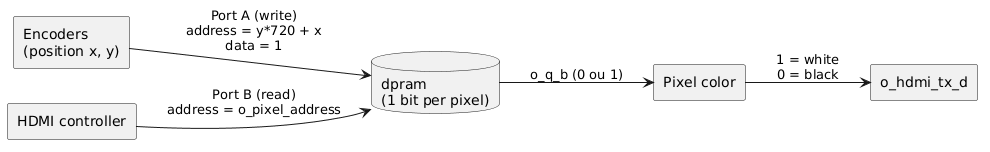

# Magic Screen / Telecran — FPGA Lab (DE10-Nano)

A digital Etch-A-Sketch ("magic screen") built on a Terasic DE10-Nano board (Cyclone V), driven by two rotary encoders and displayed over HDMI. Turning the encoders moves a drawing cursor across a 720x480 frame; the trail it leaves is kept in a dual-port RAM framebuffer and streamed out to the screen in real time.

This was a 3-session lab for the FPGA course at ENSEA (Cergy, France), done with [Ana Carolina](https://github.com/anauehara).

## How it works



- **Encoders** — each rotary encoder outputs two quadrature signals (A/B). A debounce stage cleans the raw signal, and an edge detector turns rotation into increment/decrement pulses on an x or y position register.
- **Memory write path** — the current (x, y) position is turned into a RAM address and a "pixel on" value is written to it whenever the cursor moves.
- **Memory** — a dual-port block RAM (`dpram`) stores one bit per pixel for the whole 720x480 frame. Port A is used to write new pixels from the encoders; Port B is read continuously by the HDMI controller.
- **HDMI controller** — generates HSYNC/VSYNC/data-enable timing for 720x480 and the current pixel address, which is used to read the framebuffer and output white/black pixels.

### Framebuffer read/write



Port A address is `y * 720 + x` (write, data = `1`), Port B address is the HDMI controller's `o_pixel_address` (read). The single output bit from the RAM is mapped to white (`1`) or black (`0`) and driven onto `o_hdmi_tx_d`.

## Repository layout

| Path | Contents |
| --- | --- |
| [`telecran/`](telecran) | Top-level Quartus project (`telecran.vhd`) for the DE10-Nano: encoders, framebuffer and HDMI output wired together, plus the HDMI I2C configuration (`i2c/`) and the PLL IP (`pll/`) |
| [`HDMI/`](HDMI) | HDMI timing controller module, simulated standalone before being integrated into `telecran` |
| `debounce.vhdl` / `debounce_tb.vhdl` / `debounce.do` | Encoder signal debounce module and its ModelSim testbench |
| `encoder.vhdl` / `encoder_tb.vhdl` / `encoder.do` | Quadrature decoder (rotation → increment/decrement) and its testbench |
| `encoder_clk.vhdl` / `encoder_clk_pins.qsf` | Standalone encoder test build used to validate pin assignments on the board |
| `frequency_divider.vhdl` / `frequency_divider_tb.vhdl` / `frequency_divider.do` | Clock divider used while debugging on-board timing |
| `diagrama.dot` / `diagrama.svg` | Source and rendered version of the block diagram above |
| `diagrama_memoria.png` | Framebuffer read/write diagram above |
| `rtl.pdf` | Quartus RTL Viewer schematic of the synthesized `telecran` design |
| `quartus_flow_summary.txt` | Quartus compilation report (device, resource usage, timing) for the last successful build |
| `fpga_tp_english.md` | Original lab handout (English translation) with the step-by-step assignment |

## Synthesis results

Target device: Cyclone V `5CSEBA6U23I7` (DE10-Nano), Quartus Prime Lite 24.1.

| Resource | Usage |
| --- | --- |
| ALMs | 742 / 41,910 (2%) |
| Registers | 331 |
| Pins | 57 / 314 (18%) |
| Block memory bits | 345,600 / 5,662,720 (6%) |
| DSP blocks | 2 / 112 (2%) |
| PLLs | 1 / 6 (17%) |

See [`quartus_flow_summary.txt`](quartus_flow_summary.txt) for the full report and [`rtl.pdf`](rtl.pdf) for the synthesized RTL schematic.

## Simulation

Each module has a ModelSim `.do` script next to it (e.g. `encoder.do`, `debounce.do`). Open ModelSim in the module's folder and run:

```tcl
do <module>.do
```

It compiles the sources, runs the testbench and opens the wave window.

## Building for the board

1. Open `telecran/telecran.qpf` in Quartus Prime (Lite Edition, tested with 24.1).
2. Compile the design (`Compile Design`).
3. Program the DE10-Nano via the `USB BLASTER II` port with the generated `.sof` file.

Full board wiring (LEDs, encoders) is listed in [`fpga_tp_english.md`](fpga_tp_english.md).
